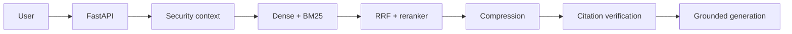

# Enterprise RAG Knowledge Platform

## Executive Summary
A production-oriented multi-tenant RAG reference platform demonstrating authorized ingestion, hybrid retrieval, reranking, contextual compression, grounded generation, and citation verification.

## Business Problem
Enterprise knowledge mixes policies, manuals, and operational documents. Exact-term search and semantic search each fail in different ways, while unverified generation creates trust and security risk.

## Architecture


## Local Deployment
```bash
cp .env.example .env
make install
make test
make dev
```

API: http://localhost:8000, Swagger: http://localhost:8000/docs. The browser demo is served with `npm install --prefix frontend && npm run dev --prefix frontend` at http://localhost:5173. Docker Compose provides API, frontend, PostgreSQL/pgvector, and Redis service boundaries; the local reference API uses deterministic in-memory adapters until persistence providers are configured.

## Key Features
- Signed local JWT authentication and role-bearing security context
- Tenant filtering before dense/sparse scoring and again at citation verification
- BM25-style lexical retrieval, deterministic dense baseline, RRF fusion, reranking, compression
- Grounded refusal when evidence is absent
- Verified citations with document, version, section, and page metadata
- React interface, Dockerfiles, CI, evaluation harness, and Mermaid architecture docs

## Security and Limitations
This is an honest production-style foundation, not a claim of production deployment, calibrated confidence, legal compliance, or fabricated benchmark performance. PostgreSQL models/migrations, hosted provider adapters, queue-backed ingestion, RLS, and full administration are extension points for the next implementation phases.

## Evaluation
Run the benchmark harness after configuring a real corpus and providers. `evaluation/reports/latest.md` explicitly records that benchmark execution is pending.

## Project Structure
`backend/` API and RAG services · `frontend/` React client · `worker/` ingestion boundary · `docs/` architecture/security/operations · `scripts/` reproducibility tools.

## License
See [LICENSE](LICENSE).