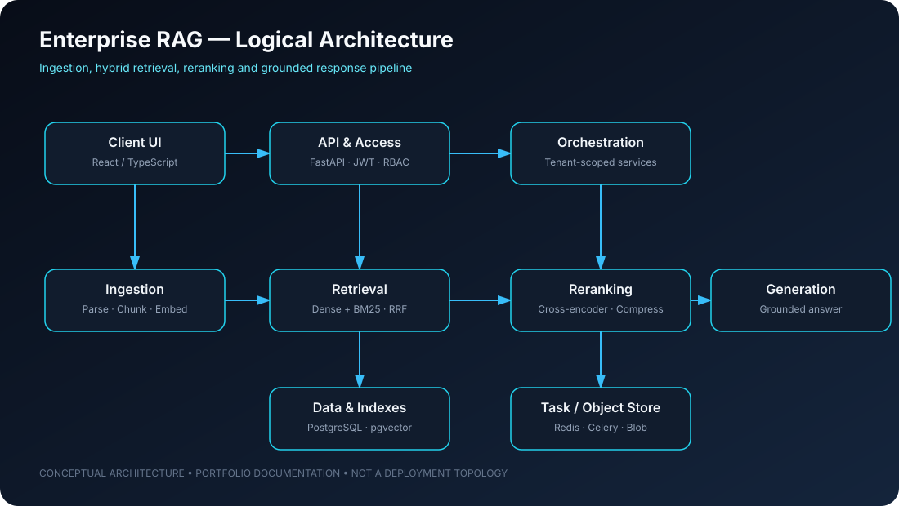

# Enterprise RAG Knowledge Platform

### Secure, multi-tenant knowledge retrieval with grounded LLM responses

**Engineering focus:** Retrieval quality · Tenant isolation · Citation verification · API services · Deployment foundations

---

## 01 — Project overview

The **Enterprise RAG Knowledge Platform** is a reference implementation of a multi-tenant Retrieval-Augmented Generation system for querying organisational knowledge stored in unstructured documents such as PDF, DOCX, Markdown and TXT.

The project focuses on engineering challenges beyond a basic document-chat demo:

- Combining semantic retrieval with exact-term search.
- Improving candidate relevance through rank fusion and reranking.
- Preserving document context with hierarchical chunking.
- Returning answers with verifiable source references.
- Enforcing tenant-scoped access controls across knowledge operations.

> **Project status:** This repository documents an engineered platform design and implementation. The architecture is not proof of a production customer deployment, independent security certification, measured retrieval accuracy, or a formal service-level agreement. Validate each capability against the current code and tests.

## 02 — System architecture

The architecture below reflects the components described in this repository. It is an architectural view, not a deployment topology or performance benchmark.

~~~mermaid
flowchart TB
    U["User / React + TypeScript UI"] --> API["FastAPI Gateway"]
    API --> AUTH["JWT / RBAC Middleware"]
    AUTH --> TENANT["Tenant Scope Enforcement"]
    TENANT --> ING["Async Ingestion"]
    TENANT --> RET["Hybrid Retrieval"]
    TENANT --> GEN["Grounded Generation"]
    ING --> PARSE["Document Parsing"]
    PARSE --> CHUNK["Hierarchical Chunking"]
    CHUNK --> PG[("PostgreSQL + pgvector")]
    CHUNK --> OBJ[("Blob / Object Storage")]
    RET --> DENSE["Dense Retrieval"]
    RET --> SPARSE["BM25 Sparse Retrieval"]
    DENSE --> FUSION["Reciprocal Rank Fusion"]
    SPARSE --> FUSION
    FUSION --> RERANK["Cross-Encoder Reranking"]
    RERANK --> COMPRESS["Contextual Compression"]
    COMPRESS --> GEN
    GEN --> VERIFY["Citation Verification"]
    VERIFY --> RESP["Grounded Response"]
    ING --> REDIS[("Redis / Celery Broker")]
    API --> DB[("PostgreSQL Metadata")]
~~~

### Ingestion path

1. Accept supported document formats.
2. Parse document content and metadata.
3. Split content using hierarchical chunking.
4. Generate dense representations for vector retrieval.
5. Persist document and retrieval data in configured storage components.

### Retrieval and generation path

1. Retrieve candidates through dense and sparse retrieval.
2. Combine rankings using Reciprocal Rank Fusion (RRF).
3. Rerank candidates with a cross-encoder.
4. Compress the context passed to the generation stage.
5. Generate an answer grounded in retrieved context.
6. Verify citations against available source references.

## 03 — Engineering components

| Component | Responsibility |
|---|---|
| FastAPI | HTTP API and service boundary |
| JWT / RBAC | Authentication and role-based access layer |
| Tenant enforcement | Tenant-scoped request and data access |
| PostgreSQL + pgvector | Relational persistence and dense vector search |
| BM25 | Sparse lexical retrieval |
| RRF | Fusion of dense and sparse rankings |
| Cross-encoder | Candidate reranking |
| Contextual compression | Reduce retrieved context before generation |
| Redis / Celery | Cache and asynchronous task-broker components |
| Blob storage | Document object storage integration |
| Docker / Terraform | Container and infrastructure tooling |

## 04 — Technology stack

- **Application:** Python 3.12+, FastAPI
- **Retrieval:** pgvector, BM25, Reciprocal Rank Fusion
- **Ranking:** Cross-encoder reranking, contextual compression
- **Persistence:** PostgreSQL, Redis
- **Processing:** Asynchronous ingestion, hierarchical chunking
- **Platform:** Docker, Terraform
- **Client:** React and TypeScript, as represented in the architecture

## 05 — Local setup

### Prerequisites

- Python 3.12 or later
- Docker and Docker Compose, if using the container workflow
- PostgreSQL with pgvector support
- Redis, if using asynchronous task and cache components
- Provider credentials and model configuration appropriate to your environment

~~~bash
git clone https://github.com/alimulfazalnabil/LLM-enterprise-rag-knowledge-platform.git
cd LLM-enterprise-rag-knowledge-platform

cp .env.example .env
# Review and configure .env before starting services.

make help
~~~

Use the repository Makefile, application configuration and CI workflow as the source of truth for supported commands. Never commit API keys, database passwords or production credentials.

## 06 — Security and reliability considerations

The design calls attention to the following controls; effectiveness depends on implementation and configuration:

- Enforce tenant scope on every document and retrieval query.
- Apply least-privilege roles to application and database identities.
- Keep secrets outside Git and rotate credentials.
- Validate file type, size and parsing behaviour at ingestion boundaries.
- Treat retrieved document content as untrusted input.
- Log request identifiers and operational events without exposing sensitive document content.
- Test citation validity, tenant isolation and retrieval permissions.

## 07 — Evaluation plan

A credible RAG system needs measurable evaluation, not only a successful demo.

| Dimension | Example measurement |
|---|---|
| Retrieval relevance | Recall@k, Precision@k, nDCG |
| Answer grounding | Citation coverage and factual support review |
| Hallucination control | Unsupported-claim rate on a curated test set |
| Access control | Cross-tenant negative tests |
| Performance | p50/p95 latency by pipeline stage |
| Operations | Error rate, queue depth and resource utilisation |

No benchmark values are claimed here. Add measured results only after running a reproducible evaluation set and documenting its methodology.

## 08 — Roadmap

- [ ] Publish a reproducible evaluation dataset and scoring report.
- [ ] Add automated tenant-isolation and citation-verification tests.
- [ ] Document supported model providers and embedding dimensions.
- [ ] Add service-level observability for ingestion and retrieval stages.
- [ ] Publish a reproducible local deployment walkthrough.
- [ ] Add threat modelling for prompt injection and malicious documents.

## Maintainer

**Alimul Fazal Nabil** — AI Solutions Engineer | Cloud & Infrastructure Engineering

[GitHub](https://github.com/alimulfazalnabil) · [LinkedIn](https://www.linkedin.com/in/alimul-fazal-nabil/) · [Portfolio](https://alimulfazalnabil.github.io/)

---

*Technical portfolio project. Architecture descriptions are not a substitute for deployment evidence, independent security review or measured production results.*
