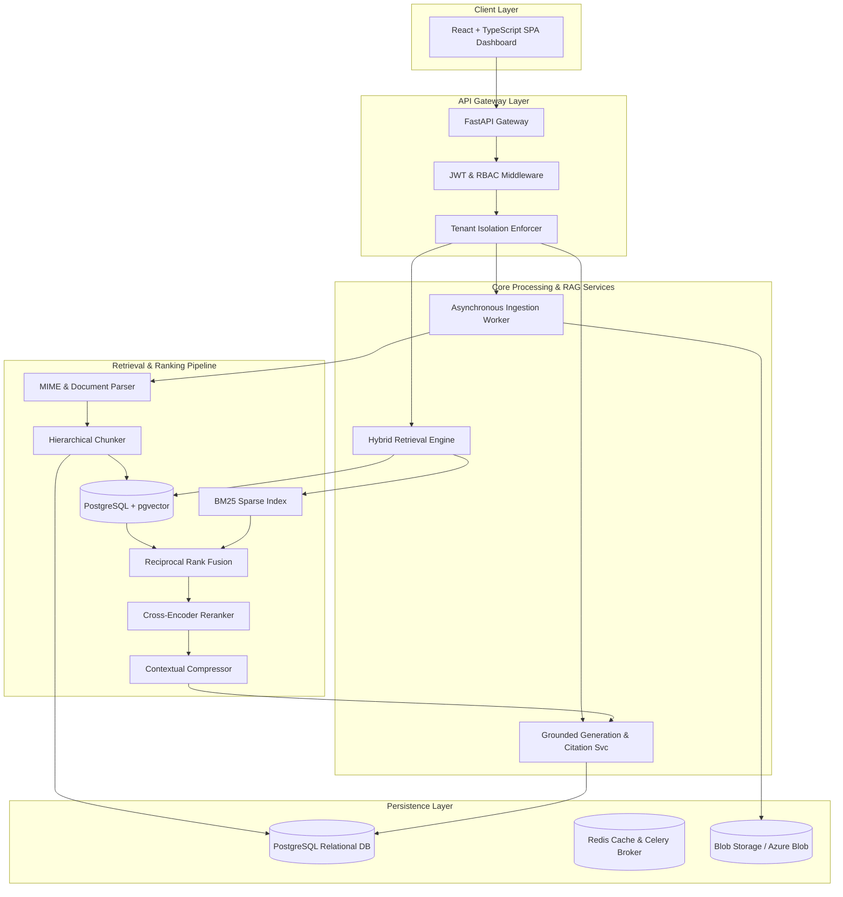

# Enterprise RAG Knowledge Platform

---

## Executive Summary

The **Enterprise RAG Knowledge Platform** is a production-grade, multi-tenant Retrieval-Augmented Generation (RAG) system engineered for secure enterprise deployments. It solves the critical institutional knowledge fragmentation problem faced by large organizations where crucial operational guidelines, technical manuals, HR policies, and compliance standards are locked across unstructured repositories (PDF, DOCX, Markdown, TXT).

Unlike basic chatbot demos or naive vector search wrappers, this platform implements a rigorous engineering pipeline combining **Hybrid Retrieval (Dense `pgvector` + Sparse BM25)**, **Reciprocal Rank Fusion (RRF)**, **Cross-Encoder Reranking**, **Contextual Compression**, **Hierarchical Chunking**, **Deterministic Citation Verification**, and **Defense-in-Depth Tenant-Scoped RBAC**.

---

## Business Problem

In enterprise environments, employees waste hundreds of hours annually searching fragmented internal knowledge bases. Traditional keyword search fails when users describe concepts using synonyms, acronyms, or phrasing different from source documents. Conversely, naive vector search suffers from:
* **Poor exact-term matching** for product codes, part numbers, and technical identifiers.
* **Weak handling of domain acronyms** and rare professional terminology.
* **Retrieval noise**, pulling highly semantic but factually irrelevant passages.
* **Hallucination risks**, where LLMs synthesize unverified claims when internal knowledge is missing.

**The Solution**: An enterprise-ready RAG pipeline that guarantees strict tenant isolation, verified factual grounding, and auditability across all knowledge operations.

---

## System Architecture

