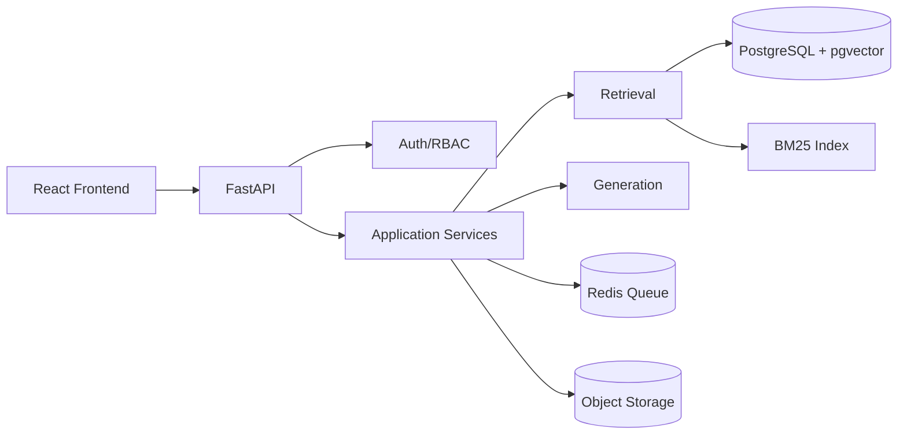
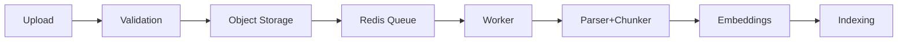
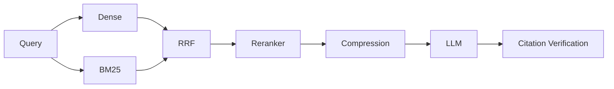
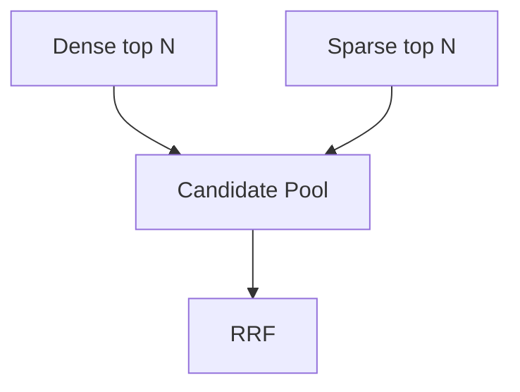
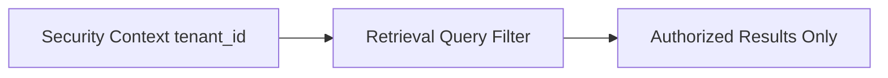
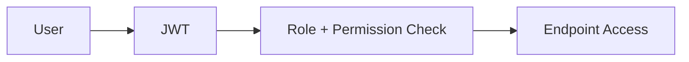
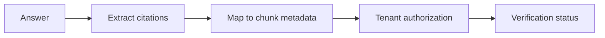
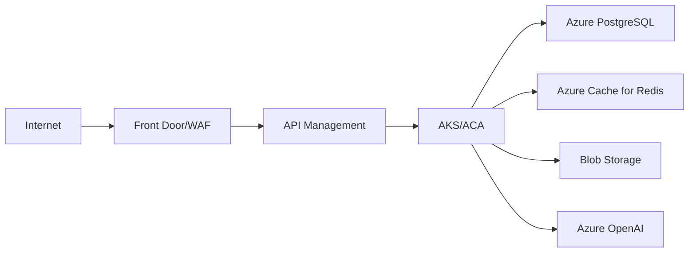
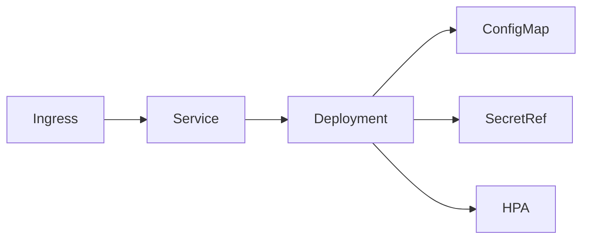
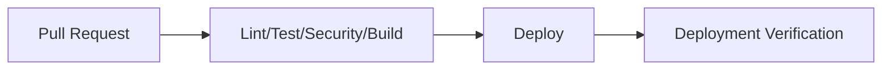

# Architecture

## 1. System architecture

## 2. Document ingestion

## 3. RAG pipeline

## 4. Hybrid retrieval

## 5. Tenant isolation

## 6. Authentication/RBAC

## 7. Citation verification

## 8. Azure deployment

## 9. Kubernetes deployment

## 10. CI/CD

