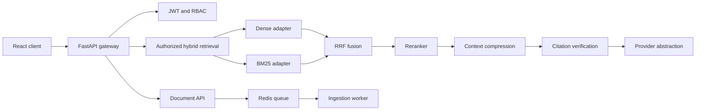

# System Architecture

The current local profile uses an in-memory store and deterministic retrieval so the demo is runnable without credentials. Production profiles should replace these adapters with PostgreSQL/pgvector, Redis, object storage, and configured model providers.
